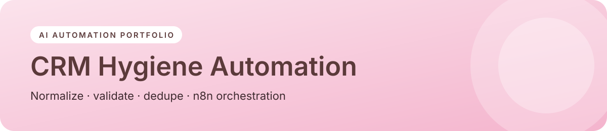

<p align="center"></p>

<p align="center">


<a href="https://sider.ai/agents/web-creator/share/695ea81100a621619985fdfb"></a>
</p>

<p align="center"><a href="https://naekitakadoportfolio.github.io/crm-hygiene-automation/"></a></p>

# CRM Hygiene Automation

A nightly data-quality pipeline for CRM contacts. It **normalizes** messy records, **validates** fields, **detects duplicates** with fuzzy matching, and sends a **merge review queue** to Slack. Nothing destructive happens without a human approving it.

> Fictional sample data. Portfolio demo by Nae Kitakado.

## The problem
Duplicate and incomplete contacts break lead routing, inflate pipeline reports, and waste rep time. This pipeline gives RevOps a measurable **data quality score** to track over time.

## What it demonstrates
| Skill | Where |
|---|---|
| Data transformation and normalization (email, phone, company suffixes) | `normalize()` |
| Field validation rules | `validate()` |
| Fuzzy duplicate detection with weighted scoring | `similarity()`, `find_duplicates()` |
| Human-in-the-loop merge queue (no auto-deletes) | `merge_review_queue` |
| Baseline metric for measuring impact | `data_quality_score` |
| Orchestration: n8n workflow (Schedule → HubSpot → script → IF → Slack) | `n8n/crm-hygiene-workflow.json` |

## Run it
```bash
python src/hygiene.py
pytest -q
```
Import `n8n/crm-hygiene-workflow.json` into n8n to see the orchestration layer.

## Sample result
6 records → 2 duplicate pairs found (same email, name and company variants), 1 invalid email, 2 missing owners, with a quality score you can track week over week.

---
<p align="center"><sub>Built by <b>Nae Kitakado</b>, AI Automation Consultant · <a href="https://www.linkedin.com/in/nae-k-203194265">LinkedIn</a> · <a href="https://sider.ai/agents/web-creator/share/695ea81100a621619985fdfb">Portfolio</a> · open to retainer &amp; part-time consulting</sub></p>
